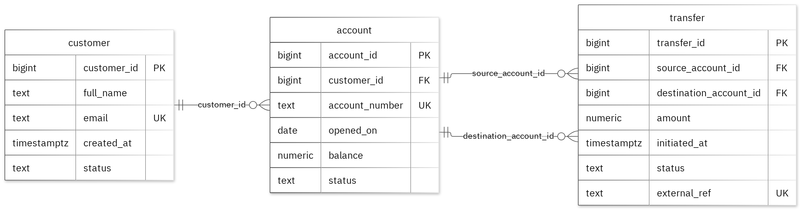

# Bank Platform — Advanced Database Systems Portfolio

**MIT 8103 Advanced Database Systems** · Miracle Tanimola · Student ID 301919757

This repository contains my five-part database portfolio for **Bank Platform**, a fictional banking case study. It covers relational database design, query optimisation, transactions and concurrency, NoSQL data modelling, and a proposed distributed database architecture. All customer records, account numbers, transfer details and event data are synthetic and used only for demonstration.

## Case study

Bank Platform represents a banking system in which customers hold accounts and initiate transfers, while bank operations staff review account and transfer activity. The database design focuses on:

- maintaining customer and account records without unnecessary duplication;
- associating each account with an existing customer;
- recording transfers between valid, distinct accounts;
- enforcing positive transfer amounts and non-negative account balances;
- examining SQL query performance on a larger synthetic transfer dataset;
- testing transaction isolation and concurrent updates; and
- representing transfer lifecycle events in a document database.

The relational model uses three tables in the PostgreSQL `portfolio` schema:

| Table | Purpose | Key rules |
| --- | --- | --- |
| `customer` | Stores customer identifiers, names, contact details and customer status | Primary key `customer_id`; unique `email`; required fields |
| `account` | Records bank accounts, their owners, opening dates, balances and statuses | Primary key `account_id`; unique `account_number`; `customer_id` references an existing customer; `balance >= 0` |
| `transfer` | Records transfers between a source account and a destination account | Primary key `transfer_id`; unique `external_ref`; both accounts must exist and differ; `amount > 0` |

The database schema enforces these structural and value constraints. The broader requirement to validate available funds and atomically update both account balances is documented as a banking design requirement; the included concurrency experiment uses a temporary counter rather than executing an end-to-end funds-transfer workflow.



## Technologies

- **PostgreSQL / `psql`** — relational schema, integrity constraints, SQL queries, execution plans, indexes, transactions and row-level locking (Portfolios 1–3).
- **MongoDB / `mongosh`** — event documents, embedded snapshots, JSON Schema validation, indexing and queries (Portfolio 4).
- **Mermaid** — source representation of the relational entity-relationship diagram.
- **Markdown and screenshots** — documentation and evidence for each portfolio exercise.

## Portfolio overview

| # | Topic | What it covers | Key result |
| --- | --- | --- | --- |
| 1 | [Database Design and Modelling](portfolio-1-database-design/) | `customer`, `account` and `transfer` tables; keys, foreign keys, check constraints, ER diagram and normalisation through 3NF | **13 deliberately invalid inserts** were rejected, with the valid sample records unchanged |
| 2 | [Query Processing and Optimisation](portfolio-2-query-optimisation/) | SQL joins, filters and aggregation; `EXPLAIN (ANALYZE, BUFFERS)`; B-tree index on a 50,000-row synthetic performance table | Median lookup time fell from **2.452 ms to 0.324 ms**, with matching results and a plan change from sequential scan to bitmap index scan |
| 3 | [Transactions and Concurrency](portfolio-3-transactions-concurrency/) | `COMMIT`, `ROLLBACK`, `READ COMMITTED`, a two-session lost-update demonstration and `SELECT ... FOR UPDATE` | An unlocked update finished at **2 instead of 3**; row locking preserved both increments and produced **3** |
| 4 | [NoSQL and Advanced Data Models](portfolio-4-nosql/) | MongoDB `bank_events` collection, transfer event snapshots, flexible metadata, schema validation, indexes and queries | **2 event documents** inserted; invalid date type (code `121`) and duplicate event ID (code `11000`) rejected |
| 5 | [Distributed and Cloud Database](portfolio-5-distributed-cloud/) | Proposed three-member MongoDB replica set, majority acknowledgement, elections, replication lag, sharding trade-offs, backups and security | **Design discussion only**; no live replica set, cloud deployment or failover experiment was performed |

Each portfolio directory contains its own detailed README, implementation files where applicable, result explanations and supporting screenshots.

## Repository structure

```text
.
├── README.md
├── Tanimola_Miracle_301919757_FinalSummary.md     # Final portfolio report
├── Tanimola_Miracle_301919757_FinalSummary.pdf    # PDF report
├── images/
│   └── Tanimola_Miracle_301919757_ERDiagram.png
├── portfolio-1-database-design/
│   ├── Tanimola_Miracle_301919757_P1_README.md
│   ├── Tanimola_Miracle_301919757_P1_Schema.sql
│   ├── Tanimola_Miracle_301919757_P1_SampleData.sql
│   ├── Tanimola_Miracle_301919757_P1_ConstraintTests.sql
│   ├── Tanimola_Miracle_301919757_P1_Design.md
│   ├── Tanimola_Miracle_301919757_P1_Normalisation.md
│   ├── Tanimola_Miracle_301919757_P1_ERDiagram.md
│   └── screenshots/
├── portfolio-2-query-optimisation/
│   ├── Tanimola_Miracle_301919757_P2_README.md
│   ├── Tanimola_Miracle_301919757_P2_Queries.sql
│   ├── Tanimola_Miracle_301919757_P2_Optimisation.sql
│   └── screenshots/
├── portfolio-3-transactions-concurrency/
│   ├── Tanimola_Miracle_301919757_P3_README.md
│   ├── Tanimola_Miracle_301919757_P3_Transactions.sql
│   ├── Tanimola_Miracle_301919757_P3_SessionA.sql
│   ├── Tanimola_Miracle_301919757_P3_SessionB.sql
│   └── screenshots/
├── portfolio-4-nosql/
│   ├── Tanimola_Miracle_301919757_P4_README.md
│   ├── Tanimola_Miracle_301919757_P4_MongoDB.js
│   └── screenshots/
└── portfolio-5-distributed-cloud/
    ├── Tanimola_Miracle_301919757_P5_README.md
    └── screenshots/
```

## Running the scripts

**Prerequisites:** PostgreSQL with the `psql` command-line client, MongoDB with `mongosh`, and a local copy of this repository. Run the examples from the repository root. Use a **fresh PostgreSQL database** for each relational exercise because the setup scripts create schemas and other objects that are not designed to be recreated on top of an earlier run.

### Portfolio 1 — Database design

Create a fresh PostgreSQL database, then run the schema and sample-data scripts in order:

```bash
createdb bank_platform_p1
psql -d bank_platform_p1 -f portfolio-1-database-design/Tanimola_Miracle_301919757_P1_Schema.sql
psql -d bank_platform_p1 -f portfolio-1-database-design/Tanimola_Miracle_301919757_P1_SampleData.sql
```

Open `portfolio-1-database-design/Tanimola_Miracle_301919757_P1_ConstraintTests.sql` and execute its **13 invalid `INSERT` statements individually**, outside a transaction. Each is expected to fail at its designated constraint; those errors are evidence of the tests working.

### Portfolio 2 — Query optimisation

Start with a separate fresh database loaded with the Portfolio 1 schema and sample data. Then run:

```bash
createdb bank_platform_p2
psql -d bank_platform_p2 -f portfolio-1-database-design/Tanimola_Miracle_301919757_P1_Schema.sql
psql -d bank_platform_p2 -f portfolio-1-database-design/Tanimola_Miracle_301919757_P1_SampleData.sql
psql -d bank_platform_p2 -f portfolio-2-query-optimisation/Tanimola_Miracle_301919757_P2_Queries.sql
psql -d bank_platform_p2 -f portfolio-2-query-optimisation/Tanimola_Miracle_301919757_P2_Optimisation.sql
```

The optimisation script creates a separate `query_lab.transfer` table with **50,000 synthetic rows**. It runs the same selective timestamp lookup before and after creating `p2_filter_idx` on `initiated_at`, recording execution plans and timings with `EXPLAIN (ANALYZE, BUFFERS)`.

### Portfolio 3 — Transactions and concurrency

Start with another fresh PostgreSQL database loaded with the Portfolio 1 schema and sample data, and run:

```bash
createdb bank_platform_p3
psql -d bank_platform_p3 -f portfolio-1-database-design/Tanimola_Miracle_301919757_P1_Schema.sql
psql -d bank_platform_p3 -f portfolio-1-database-design/Tanimola_Miracle_301919757_P1_SampleData.sql
psql -d bank_platform_p3 -f portfolio-3-transactions-concurrency/Tanimola_Miracle_301919757_P3_Transactions.sql
```

Open **two `psql` sessions connected to the same database**. Follow the numbered instructions in `Tanimola_Miracle_301919757_P3_SessionA.sql` and `Tanimola_Miracle_301919757_P3_SessionB.sql` in the prescribed interleaved order. The experiment uses a temporary `p3_processed_count` field on the `transfer` table to compare concurrent updates with and without row locking. Follow the portfolio-specific README for the complete sequence.

### Portfolio 4 — MongoDB event modelling

With MongoDB available locally, run the JavaScript from the repository root:

```bash
mongosh --file portfolio-4-nosql/Tanimola_Miracle_301919757_P4_MongoDB.js
```

The script selects the `portfolio_nosql` database, creates `bank_events`, inserts two sample events, creates an index, runs four queries and tests invalid data. Run it against a fresh exercise database because the script intentionally refuses to recreate an existing `bank_events` collection.

### Portfolio 5 — Distributed database proposal

There is no script to execute. Read the [Portfolio 5 design discussion](portfolio-5-distributed-cloud/Tanimola_Miracle_301919757_P5_README.md) and its architecture diagram. It proposes a replica set spanning three availability zones but does not claim a deployed or tested cluster.

**Reproducibility note:** Execution times vary by hardware, database statistics, cache state and environment. The results reported above are measurements documented in this portfolio, not guaranteed timings for another installation.

## Final summary

The [final written summary](Tanimola_Miracle_301919757_FinalSummary.md) and [submission PDF](Tanimola_Miracle_301919757_FinalSummary.pdf) bring together the case study, results across all five portfolios, individual reflection, AI-use declaration and references.

## References

- [PostgreSQL: Constraints](https://www.postgresql.org/docs/17/ddl-constraints.html)
- [PostgreSQL: Using EXPLAIN](https://www.postgresql.org/docs/17/using-explain.html)
- [PostgreSQL: Transaction Isolation](https://www.postgresql.org/docs/17/transaction-iso.html)
- [PostgreSQL: Explicit Locking](https://www.postgresql.org/docs/17/explicit-locking.html)
- [MongoDB: Data Modeling](https://www.mongodb.com/docs/manual/data-modeling/)
- [MongoDB: Replication](https://www.mongodb.com/docs/manual/replication/)
- [MongoDB: Sharding](https://www.mongodb.com/docs/manual/sharding/)
- [Mermaid: Entity Relationship Diagrams](https://mermaid.js.org/syntax/entityRelationshipDiagram.html)
