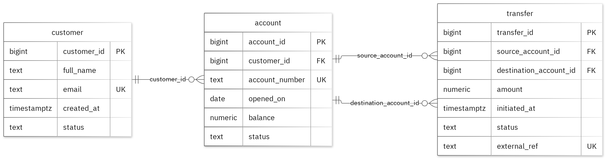

# MIT 8103 Advanced Database Systems

**Bank Platform** · Miracle Tanimola · Student ID 301919757

## Case study

My case study is Bank Platform. I designed the database for customers initiating transfers between their accounts and bank operations staff reviewing accounts and transfer activity, using separate customer, account and transfer tables. It supports creating customers and accounts with synthetic identifiers and details; checking that both accounts exist and the source has sufficient funds; committing transfers and both balance changes atomically or rolling back on failure; and
benchmarking a date-range filter over 50,000 synthetic transfer rows with and without a B-tree index on initiated_at.

## Portfolio 1: Database Design and Modelling

I organized the relational design into 3 tables. Primary keys identify records, foreign keys preserve the links, and checks enforce the stated business rules. An account balance must be greater than or equal to zero after each committed update. The normalisation examples show the sample data at 1NF, 2NF and 3NF. All 13 deliberately invalid inserts were rejected without changing the valid sample rows.

Figure 1. Tables, keys and relationships. PK: primary key; FK: foreign key; UK: unique value.

<!-- PAGE BREAK -->

## Portfolio 2: Query Processing and Optimisation

I ran three SQL queries against the sample records. The join returned 3 rows and included Avery Stone with SYN-ACCT-001. For the index comparison, I used 50,000 separate performance rows. The median lookup time changed from 2.452 ms to 0.324 ms. Both phases returned the same records. The measured plan used the new index. These timings apply to this lookup and environment.

## Portfolio 3: Transactions and Concurrency

I used a temporary counter on transfer to test COMMIT, ROLLBACK and READ COMMITTED isolation. The uncommitted update remained hidden from the other session, and ROLLBACK restored the earlier committed value. Without locking, two increments left the counter at 2. With SELECT FOR UPDATE, Session B waited for Session A and the final value was 3. The helper is confined to this exercise; the case's original business fields stay unchanged.

## Portfolio 4: NoSQL and Advanced Data Models

I used bank_events for the case's event documents. MongoDB inserted 2 sample events and returned the expected results for 4 queries. Validation rejected an invalid date type and a duplicate event ID. Embedded snapshots keep related details with an event, while the details field can differ by event type. These are fictional events; PostgreSQL continues to enforce its relational rules.

## Repository and evidence

https://github.com/ScriptSticks/Tanimola_Miracle_301919757

The portfolio folders contain the SQL and JavaScript, explanations, query plans, result tables and screenshots.

<!-- PAGE BREAK -->

## Portfolio 5: Distributed and Cloud Database Exercise

I proposed three MongoDB replica members across separate failure zones. The discussion covers primary elections, majority acknowledgement, secondary lag and sharding trade-offs for bank_events. Replication supports availability, while backups address recovery. PostgreSQL needs its own availability plan. This is the permitted discussion option; no live replica set or failover test was deployed.

## Individual reflection

This project helped me apply MIT 8103 Advanced Database Systems to a banking platform. I kept customer, account and transfer in separate tables so the customer and account details would not be repeated in every transaction. Primary keys, foreign keys and unique values maintain their relationships, while constraints enforce the rules. An account balance must stay greater than or equal to zero after each committed update. The invalid-insert tests checked this alongside the
required values and links. The two-session exercise showed how concurrency can affect consistency. Both sessions can read the same value before either update commits, causing a lost increment without locking. Using SELECT FOR UPDATE made Session B wait and preserved both increments. COMMIT and ROLLBACK also showed how transaction boundaries protect the data. The indexing exercise showed why a correct query result is not enough on its own. A B-tree index on initiated_at improved the median date-range lookup from 2.452 ms to 0.324 ms, while returning the same records. Reviewing the execution plan helped me connect the performance difference to how the database carried out the query. MongoDB helped me understand how document records support varied bank event details,
although validation is still important. The distributed exercise introduced replication, availability, backups and sharding trade-offs. Overall, the project reinforced the need to design carefully, test constraints and concurrent updates, inspect execution plans and plan for recovery. These exercises made the Bank Platform case more practical.

## AI-use declaration

I used GitHub Copilot to help prepare the database model, scripts and explanations. I remain responsible for checking and explaining the submitted work.

## References

- [PostgreSQL: constraints](https://www.postgresql.org/docs/17/ddl-constraints.html)
- [PostgreSQL: EXPLAIN](https://www.postgresql.org/docs/17/using-explain.html)
- [PostgreSQL: isolation](https://www.postgresql.org/docs/17/transaction-iso.html)
- [PostgreSQL: row locks](https://www.postgresql.org/docs/17/explicit-locking.html)
- [MongoDB: data modelling](https://www.mongodb.com/docs/manual/data-modeling/)
- [MongoDB: replication](https://www.mongodb.com/docs/manual/replication/)
- [MongoDB: sharding](https://www.mongodb.com/docs/manual/sharding/)
- [Mermaid: ER diagrams](https://mermaid.js.org/syntax/entityRelationshipDiagram.html)

